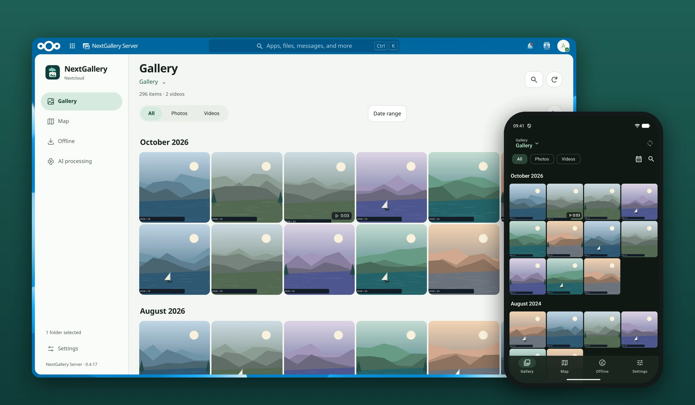
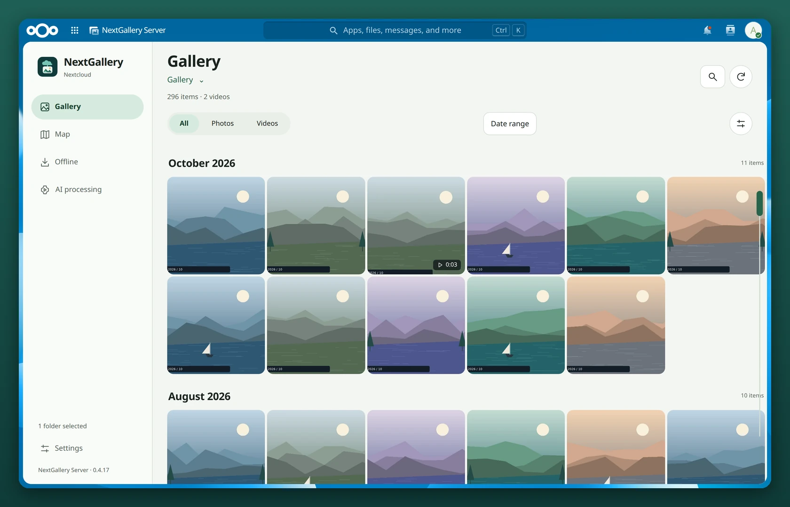
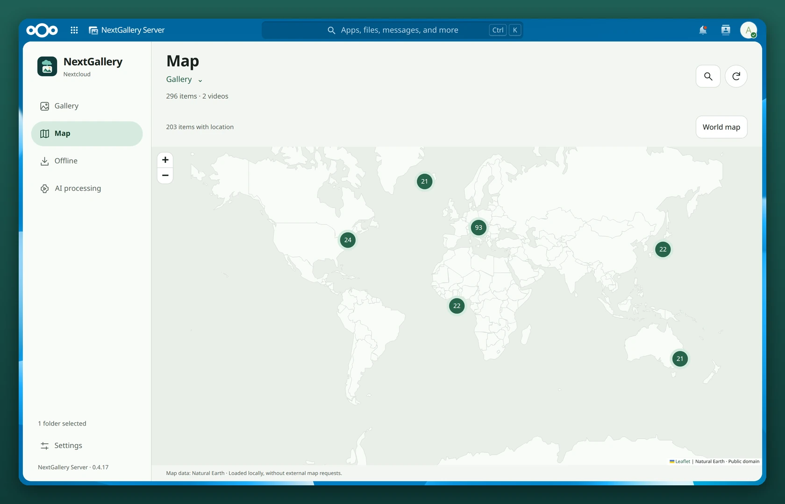
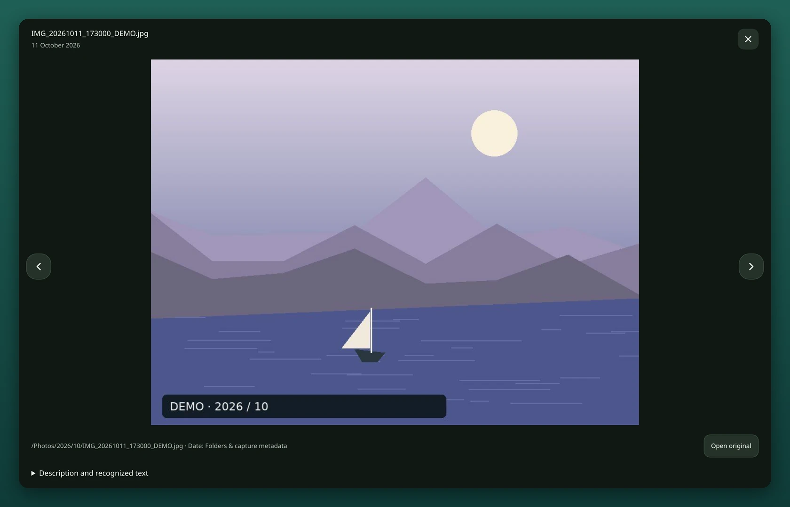
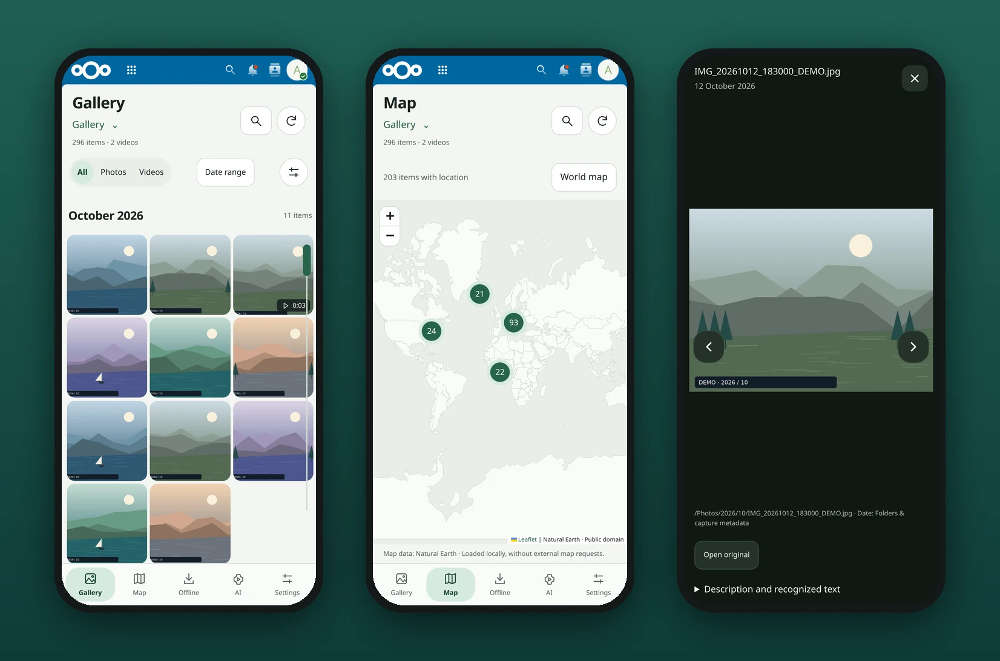
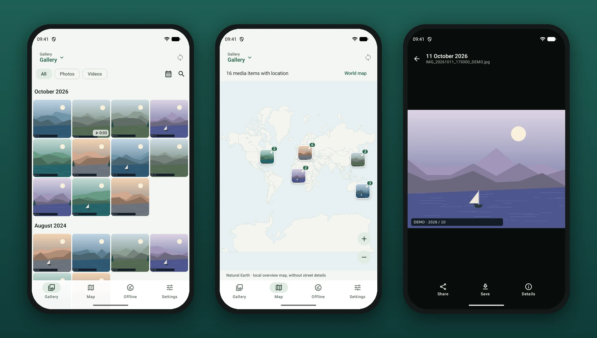

# NextGallery

**Your Nextcloud photos as one beautiful timeline, in the browser and on Android.**

Scroll through years of photos and videos by date, see on a world map where they were taken, keep previews for offline browsing and, if you like, search for what is *in* a picture. 
No import, no copies: NextGallery shows the folders you already have.

  

[Install](docs/ADMINISTRATION.md#build-and-install) · [Android app](https://github.com/wolpa29/app-nextgallery) · [Deutsch](docs/README.de.md) · [Feedback & issues](https://github.com/wolpa29/nextcloud-nextgallery/issues)

 

## At a glance

| 🗓️ Timeline | 🗺️ World map | 🖼️ Galleries |
| --- | --- | --- |
| Every photo and video from your chosen folders, grouped by year, month or day. | Photos with GPS data on a map that loads locally, without any external map service. | Named collections from Nextcloud folders: holidays, family, hobbies, anything. |
| **📴 Offline** | **🔎 Search** | **🌗 Every screen** |
| Save previews on your device or download a portable offline collection. | Search file names and, with optional AI, descriptions, tags and text in images. | Desktop and mobile, light and dark, English and German. |

## A quick tour

### Your whole library, in order

Choose your photo folders once. NextGallery puts everything into one timeline: newest or oldest first, in two to six columns, with a fast-scroll bar and a date picker for quick jumps.

<picture>
  <source media="(prefers-color-scheme: dark)" srcset="docs/images/readme/web-timeline-dark.webp">
  
</picture>

### See where your memories were made

Photos and videos with location data appear on a world map. Zoom in, open a cluster, and you're back at the moment.

### Look closer

Open any photo or video in the built-in viewer. Step through with the arrow buttons, open the original, or read its AI description.

### Right in your phone's browser

The web gallery adapts to small screens. You can also add it to the official Nextcloud Android app as an [External site](docs/ANDROID.md).

## NextGallery for Android

Prefer an app? The [NextGallery Android app](https://github.com/wolpa29/app-nextgallery) is a fast native gallery for your Nextcloud. It works **without** this server extension. Enable server mode to share the gallery index and use AI search on your phone.

## Optional AI: find more than a filename

Remember *a dog on the beach*, but not the filename? Optional AI makes processed media searchable by content:

- **Descriptions & tags** make photos and videos easier to discover.
- **Text recognition (OCR)** finds words in photographed signs or documents.
- **Visual search** finds matching images from a description of what you remember.
- **People** groups photos by familiar faces, without requiring names. Enable it explicitly for selected folders. [Setup and corrections →](docs/FACES.md)

You choose processing folders and schedules, with separate start/pause controls for each AI feature. The models can run on your own hardware. **The gallery works fine without AI.** [AI & visual search →](docs/EMBEDDINGS.md)

## Get started

1. **Ask your administrator to install NextGallery Server.** [Installation guide →](docs/ADMINISTRATION.md#build-and-install)
2. **Open NextGallery → Settings → Manage galleries.** Give your gallery a name and choose its folders.
3. **Start exploring.** Browse the timeline, try Search, or open Map.

**Requirements:** Nextcloud 32–35, supported PHP (8.2+), working previews and cron. AI additionally needs worker/model setup.

## Your files, your choices

- **Originals stay untouched.** NextGallery reads your Nextcloud folders and never moves, renames or copies your photos.
- **No external services by default.** The map ships with the app. AI uses only the model services your administrator configures. [Setup details →](docs/ADMINISTRATION.md#ai-administration-and-external-embedding-server)
- **Photos on a NAS work too.** Mounted as Nextcloud external storage, they are kept current by a nightly scan. AI results survive reorganizing folders on the NAS. [How →](docs/ADMINISTRATION.md#external-storage-nas-smb)
- **Offline means previews, not a full backup.** Playing original videos needs a connection. Reopening browser collections requires Service Worker support; portable offline files are an alternative.

All screenshots show synthetic demo images, no real photos.

---

**Learn more:** [Administration](docs/ADMINISTRATION.md) · [AI & visual search](docs/EMBEDDINGS.md) · [Embedding server setup](docs/EXTERNAL_EMBEDDING_SERVER.en.md) · [Android integration](docs/ANDROID.md) · [Migration](docs/MERGE.md) · [Validation](docs/VALIDATION.md) · [Version history](docs/CHANGELOG.md)

Open source under [AGPL-3.0-or-later](LICENSE). Third-party credits: [NOTICE](NOTICE). Running a public installation? See the [network source offer](docs/ADMINISTRATION.md#network-source-offer).
